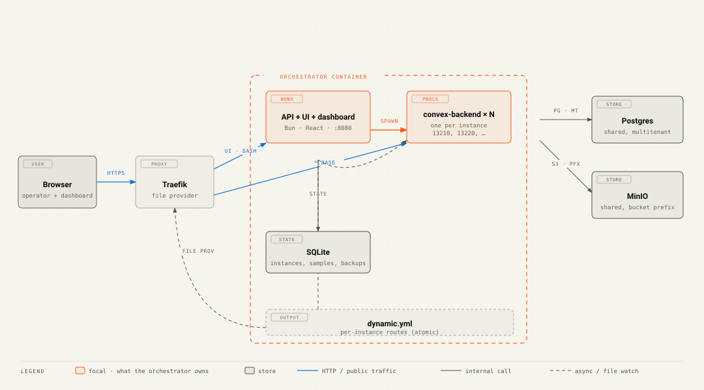
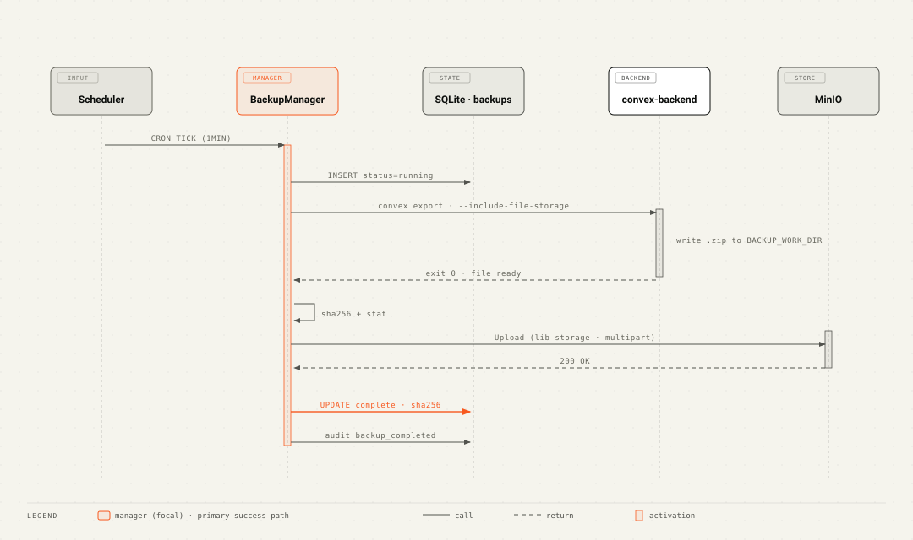
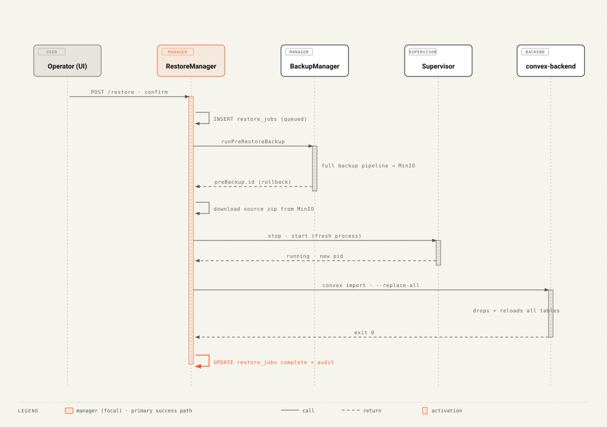
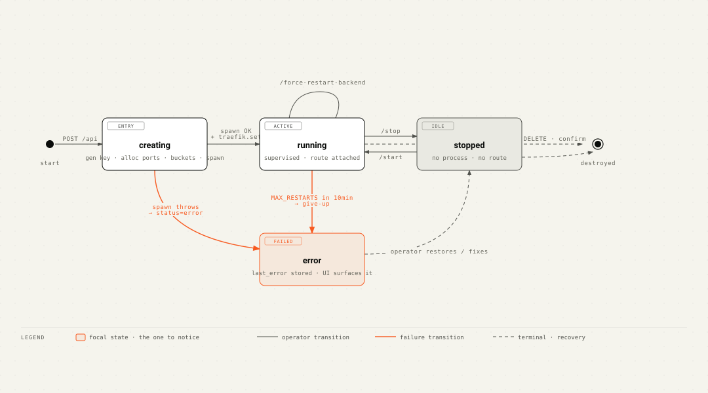

# convex-orchestrator

Run many [self-hosted Convex](https://github.com/get-convex/convex-backend) backends on a single
host, route them by subdomain through Traefik, share Postgres + MinIO, and operate the whole fleet
from one editorial web UI with the official Convex dashboard embedded per-instance.

[](https://github.com/tfohlmeister/convex-orchestrator/actions/workflows/ci.yml)
[](./LICENSE)

## Features

- **One container, N supervised backends**: each Convex deployment runs as a child process under a
  Bun-based supervisor with a backoff-aware restart watcher (`RESTART_DELAYS_MS`, `MAX_RESTARTS` in
  a 10-minute window) and per-instance resource sampling.
- **Subdomain routing via Traefik file provider**: the orchestrator atomically writes
  `dynamic.yml` so per-instance `cloud` and `site` hosts are added or removed without restarting
  Traefik. No docker socket needed.
- **One Convex dashboard for the whole fleet**: the bundled dashboard static export is served from
  the same Hono process via host-header routing; credentials are handed to the iframe over
  `postMessage` so the operator never logs in per instance.
- **Shared Postgres (multitenant) + MinIO (per-instance bucket prefix)**: keeps the resource
  footprint flat and lets `convex export`/`convex import` run against any backend without re-
  provisioning storage.
- **Scheduled backups + restore, both via Convex's own zip format**: per-instance cron, retention,
  stuck-export detection, force-restart-backend escape hatch. Restore takes a `pre-restore` backup
  first so every destructive flow has a rollback point. Restore jobs persist to SQLite and survive
  orchestrator restarts.
- **Editorial web UI**: warm-paper editorial design (Instrument Serif + Geist), per-instance
  tabs (Performance, Logs · Audit, Backups · Settings), live log tail with disconnect surfacing,
  and a sticky tab bar that survives scroll.
- **Bring-your-own auth**: optional `ORCHESTRATOR_ADMIN_TOKEN` bearer middleware with
  `timingSafeEqual`. Leave it empty and front the orchestrator with Traefik basic-auth, Authelia,
  or oauth2-proxy. The orchestrator logs a startup warning when the API is open.

## What it does



The orchestrator is one Hono process that supervises N `convex-backend` child processes inside a
single container, writes a Traefik file-provider `dynamic.yml` for per-instance host routing, and
serves both its own React UI and the bundled Convex dashboard from the same port. Backends share a
Postgres cluster in `postgres-v5-multitenant` mode and a MinIO bucket layout with per-instance
prefixes. The bundled dashboard receives credentials via `postMessage` from the orchestrator UI,
so the operator never types an admin key per instance.

Standalone editorial-styled diagrams are in [`docs/diagrams/`](docs/diagrams/); a deeper component
walkthrough plus the backup, restore, and instance-lifecycle diagrams live in
[`docs/architecture.md`](docs/architecture.md).

## Try it

The base `docker-compose.yml` pulls the `linux/amd64` image from GHCR.
No local build, no toolchain on the host.

```bash
git clone https://github.com/tfohlmeister/convex-orchestrator.git
cd convex-orchestrator/docker
cp .env.example .env
$EDITOR .env   # set BASE_DOMAIN, ORCHESTRATOR_MASTER_KEY, ...
docker compose pull
docker compose up -d
```

Open `https://orchestrator.<BASE_DOMAIN>` and create your first instance. Click **Dashboard ↗** on
any row to land in the official Convex dashboard, embedded and auto-authenticated for that
instance.

Pin a specific release for repeatable deploys by setting `ORCHESTRATOR_VERSION=0.1.0` in `.env`;
unset means `latest`.

### Dev / homelab variant (HTTP, no Let's Encrypt)

If you don't have a public domain with DNS-01 wildcard credentials, or your host already runs
something on 80/443, layer the HTTP-only dev override on top of the default file. The override
also switches from the published GHCR image to a local build from the working tree, so this is
the contributor path too:

```bash
docker compose -f docker-compose.yml -f docker-compose.dev.yml up -d --build
```

This exposes Traefik on `TRAEFIK_HTTP_PORT` (default 18000), drops the cert-resolver wiring, and
tells the orchestrator to emit `http://...:18000` origin URLs everywhere. Point `BASE_DOMAIN` at a
wildcard that resolves to the host (e.g. `*.cvx.lan` via your local DNS or `--host-resolver-rules`
in Chromium).

### Auth

By default `/api/*` is **open**. The orchestrator logs a boot-time
`WARN: ORCHESTRATOR_ADMIN_TOKEN is unset, /api/* is OPEN.` so you do not ship that config to the
public internet by accident.

Two ways to lock it down:

- **Built-in bearer**: set `ORCHESTRATOR_ADMIN_TOKEN` to ≥16 characters
  (`openssl rand -hex 32`). The UI prompts on first load, stores it in `localStorage`, and every
  `/api/*` request goes through `timingSafeEqual` against the configured token.
- **Reverse-proxy auth**: leave the token empty and front the orchestrator with Traefik's
  `basicauth`, Authelia, oauth2-proxy, or Cloudflare Access. The orchestrator honors
  `X-Forwarded-User` for audit attribution **only in open mode**; in bearer mode the audit actor
  is always `admin` to close the spoof vector.

## Backups and Restore

Each instance is backed up automatically on the orchestrator's schedule and the snapshots land in
the per-instance `<bucketPrefix>-backups` MinIO bucket. Uploads use
`@aws-sdk/lib-storage`'s `Upload` so very large zips stream in multipart with bounded memory.

Defaults:

- **Schedule**: 03:00 server-local daily (`BACKUP_DEFAULT_CRON=0 3 * * *`)
- **Retention**: 30 days (`BACKUP_RETENTION_DAYS=30`), only applied to `source=auto` rows. Manual
  and pre-restore backups are kept until you delete them.
- **Concurrency**: two backups at a time across all instances (`BACKUP_MAX_CONCURRENT=2`)
- **Storage layout**: `<instance>-backups/<instance>_<iso>_v<version>_<uuid>.zip` (Convex's own
  zip export format, includes file storage)
- **Health gating**: after `BACKUP_MAX_CONSECUTIVE_FAILURES` consecutive auto failures the
  schedule is suspended for that instance until you re-enable it from the UI.



Restore is destructive: the flow always takes a `pre-restore` backup first, then stops and
respawns the backend before running `convex import --replace-all`. If the pre-restore step fails
the restore is aborted before anything destructive happens.



Restore jobs are persisted to SQLite (the `restore_jobs` table). On orchestrator restart any
in-flight job is flipped to `failed` with a marker pointing at the audit log + the pre-restore
backup so the operator sees the real state instead of a stuck "importing" forever.

> **What's in a Convex backup zip:** table documents and file storage only. Environment variables,
> schema, functions, crons, and auth config are **not** included (see
> [Convex docs](https://docs.convex.dev/database/backup-restore)). The orchestrator surfaces this
> in the restore-confirm dialog so the operator knows to re-apply env via `npx convex env set` and
> redeploy code via `npx convex deploy` after a restore.

See [`docs/backups.md`](docs/backups.md) for retention tuning, recovery playbooks, and off-site
sync.

## Instance lifecycle



A backend can be `creating`, `running`, `stopped`, or `error`. The supervisor restarts a crashed
process per `RESTART_DELAYS_MS` (1s, 5s, 30s, 60s, ...) up to `MAX_RESTARTS` within a 10-minute
window; past the budget the row flips to `error` with the last exit code in `last_error`. A
user-initiated `stop` during the backoff window cancels the pending respawn (otherwise the
setTimeout would silently bring the backend back up after the operator told it to stop). Delete
requires typing the instance name as confirmation, same UX as Restore.

## Health and monitoring

Three unauthenticated probes for liveness, readiness, and fleet status:

| Endpoint                | Purpose                                                                                                                                                                                                                          |
| ----------------------- | -------------------------------------------------------------------------------------------------------------------------------------------------------------------------------------------------------------------------------- |
| `GET /health`           | Liveness, always 200 when the process can answer. Used by the Docker `HEALTHCHECK`.                                                                                                                                              |
| `GET /ready`            | Readiness, 200 once boot finishes (migrations + traefik write + restoreRunning), 503 before.                                                                                                                                     |
| `GET /health/instances` | Fleet aggregator. Per-instance status plus an internal reachability probe to each backend's cloud port. 200 when every `running` instance is reachable and nothing is in `error`, 503 otherwise. No version info in the payload. |

For external monitoring (Gatus, Uptime Kuma, anything else), the recommended pattern is
**end-to-end per instance**: hit `https://<instance>.<BASE_DOMAIN>/version` directly. That
exercises DNS, TLS, Traefik routing, and the backend process at once. The aggregator endpoint
is the weaker signal because it only proves the orchestrator can reach the backend on its
private port; use it for in-UI status badges and local inspection.

See [`docs/architecture.md`](docs/architecture.md) for the full payload shape and the rationale.

## Documentation

- **[Architecture](./docs/architecture.md)**: component model, data flow, the four diagrams in
  one place with prose, plus the load-bearing design decisions (why
  `postgres-v5-multitenant`, why env-vars-not-flags, why build `generate_key` from source, why
  postMessage instead of the dashboard switcher).
- **[Backups and Restore](./docs/backups.md)**: operator guide. Retention tuning,
  force-restart-backend, off-site sync, recovery playbooks.
- **[Co-hosted deployment](./docs/deploy-cohosted.md)**: running on a host that already has a
  Traefik with the file provider. UI reached via SSH local forward, per-instance Convex URLs
  stay public.

The Dockerfile pulls the Convex backend binary from the official
`get-convex/convex-backend` GitHub release (sha256-pinned per architecture), builds `generate_key`
from the same git tag (FSL-1.1-Apache-2.0 permits local builds), and bundles the dashboard static
export. No separate dashboard container needed.

## License

Apache License 2.0. See [LICENSE](./LICENSE).
