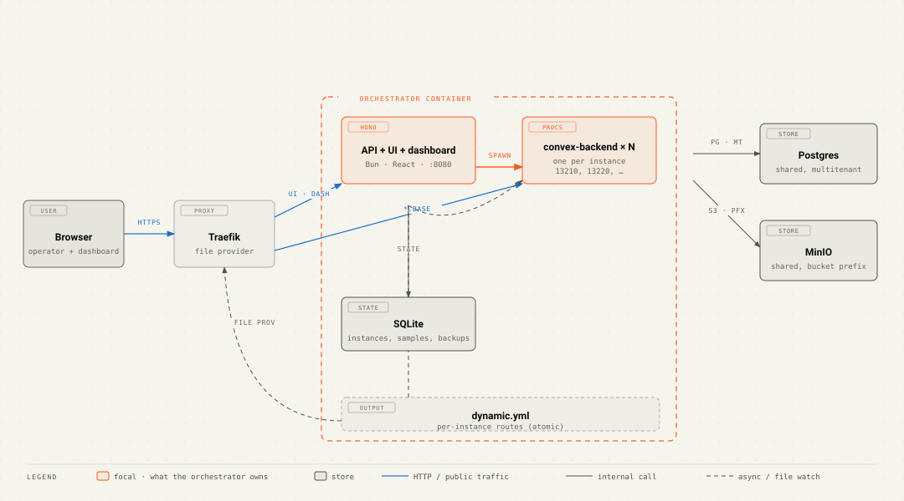
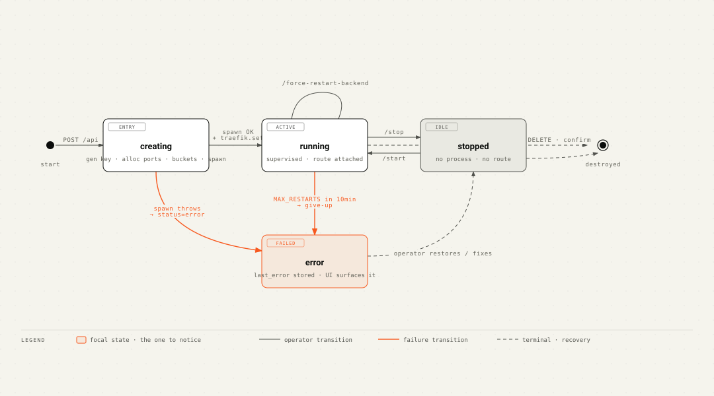
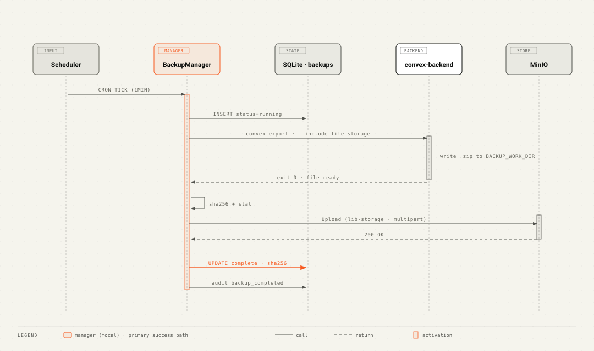
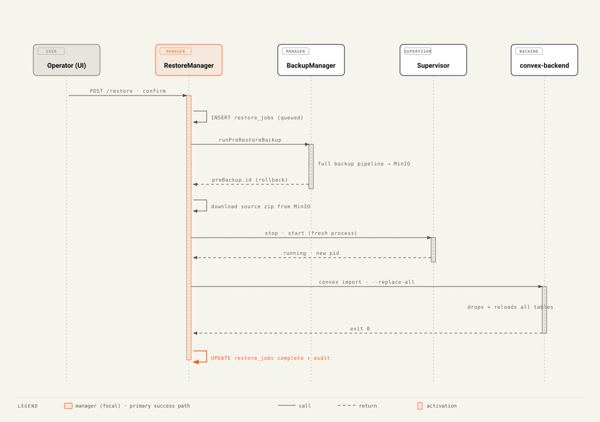

# Architecture

This page is the engineering reference for the four diagrams that appear in the README, plus the
storage layout and the runtime invariants that don't fit on a diagram.

## System overview

One Hono process inside one container does five things:

- **Serves the React UI** at `orchestrator.<base>` and proxies the bundled Convex dashboard at
  `dashboard.<base>`. Both come off the same `:8080`, distinguished by host header.
- **Owns the SQLite state**: instances, port allocations, resource samples, backups, restore jobs,
  audit log. Admin keys and instance secrets are encrypted with a key derived from
  `ORCHESTRATOR_MASTER_KEY` via HKDF-SHA256 (see `src/server/crypto.ts`).
- **Supervises one `convex-backend` child process per instance** via `src/server/supervisor/`,
  with restart backoff, resource sampling, and graceful shutdown.
- **Writes the Traefik file-provider config** (`orchestrator.yml`, path from `TRAEFIK_DYNAMIC_PATH`) atomically (temp + rename) so
  `providers.file.watch=true` never sees a partial file. Per-instance cloud and site routers are
  added or removed in place, no Traefik restart.
- **Talks to Postgres and MinIO** for shared storage. Each backend's `convex-backend` is launched
  with `-d postgres-v5` against its own database on the shared cluster, and S3 env vars pointing
  at MinIO with a per-instance bucket prefix.

Standalone editorial-styled version of this diagram lives at
[`diagrams/architecture.html`](./diagrams/architecture.html).

## Instance lifecycle

The `instances` SQLite row has a `status` column that takes one of four values: `creating`,
`running`, `stopped`, or `error`. The supervisor (`src/server/supervisor/supervisor.ts`) drives
the lifecycle and emits `onStatusChange` callbacks that write the column.

Restart policy (`src/server/supervisor/watcher.ts`):

- `RESTART_DELAYS_MS = [1000, 5000, 30_000, 60_000]`, backoff between attempts inside a window.
- `MAX_RESTARTS = 5` and `WINDOW_MS = 10 * 60_000`, at most five restarts in any ten-minute
  window before giving up.
- After give-up, the row flips to `error` with the last exit code/message in `last_error`.

Operator-initiated `stop` during the respawn backoff cancels the pending `setTimeout` so the
backend stays down. Without that cancel, the operator's stop would race the scheduled spawn, the
backend would come back up after stop returned successfully, while Traefik already removed the
route. The supervisor keeps a `pendingRespawn: Map<name, NodeJS.Timeout>` for this reason; see
`Supervisor` in `src/server/supervisor/supervisor.ts`.

On orchestrator restart, instances marked `running` are re-spawned by `restoreRunning()`;
`stopped` and `error` are left alone for operator action.

## Backup pipeline

The backup manager (`src/server/backups/manager.ts`) runs four background ticks:

- **Scheduler**, every minute. Walks instances with `backup_enabled=1`, parses each row's
  per-instance cron (falls back to `BACKUP_DEFAULT_CRON`), enqueues a job when the cron's next
  fire is in the past.
- **Stuck detector**, every minute. Any backup row in `running` for longer than
  `BACKUP_EXPORT_TIMEOUT_MINUTES` (default 30) is flipped to `stuck` and an audit row is
  recorded. The UI surfaces a force-restart-backend button on the instance detail page.
- **Retention sweeper**, daily at `BACKUP_RETENTION_HOUR` (default 04:00 server-local). Deletes
  `source=auto` rows older than the per-instance `backup_retention_days` (falls back to
  `BACKUP_RETENTION_DAYS`). `manual`, `manual-upload`, and `pre-restore` rows are kept until the
  operator deletes them.
- **Export-blob orphan cleanup**, hourly. Walks each running instance's
  `<storage-dir>/exports/` (from `CONVEX_STORAGE_DIR_TEMPLATE`) and removes `*.blob` files older
  than `EXPORT_BLOB_CLEANUP_MIN_AGE_MS`. Staged `restore_*.zip` files in `BACKUP_WORK_DIR` are
  only cleaned up inline by the restore flow itself; leftovers from a crash mid-restore are not
  swept and may need a manual delete.

The export-and-upload path itself is sequential per instance and bounded by
`BACKUP_MAX_CONCURRENT` (default 2) across the fleet, Convex's export is backend-CPU-heavy and
parallelism past 2 starves request traffic. The upload uses `@aws-sdk/lib-storage`'s `Upload`
helper so single-PUT 5 GiB cap doesn't apply.

## Restore pipeline

Every restore is destructive, `convex import --replace-all` drops and reloads every table, so
the manager forces a pre-restore backup first. If the pre-restore step fails, the restore aborts
with the original data intact (and the operator sees the failure on the restore job poll).

The stop + start dance between pre-restore and the import is load-bearing: the Convex
`ExportInProgress` lock is only released by a fresh backend process. Running the import without
the restart can deadlock on a stale lock from a previous (now-killed) export.

Restore jobs live in the `restore_jobs` SQLite table. The state transitions visible in the UI:
`queued → pre-backup → stopping → starting → importing → complete | failed`. On orchestrator
restart, any job not in `{complete, failed}` is flipped to `failed` with a marker so the operator
can locate the corresponding `pre-restore` backup (always recorded in the row) and decide whether
to retry or roll forward.

## Storage layout

- **Postgres** (shared cluster, one database per instance): backends run with `-d postgres-v5`
  and get the database named after their instance (dashes replaced by underscores, so
  `lucky-owl-755` lives in `lucky_owl_755`). The orchestrator creates that database when the
  instance is created and drops it on delete, so nothing lingers. Starting an instance only
  checks that its database is there and refuses to boot otherwise.
- **MinIO / S3** (shared): five buckets per instance, named
  `<instance>-{exports,snapshot-imports,modules,files,search}`, plus one
  `<instance>-backups` bucket the orchestrator uses for its own backup zips.
- **Local SQLite**: `instances`, `port_allocations`, `resource_samples`, `storage_samples`,
  `backups`, `restore_jobs`, `audit_log`, `schema_migrations`. Admin keys and instance secrets
  are encrypted at rest (AES-256-GCM, key derived from `ORCHESTRATOR_MASTER_KEY` via HKDF-SHA256).

## Routing

The orchestrator owns `${TRAEFIK_DYNAMIC_PATH}` (default
`/etc/traefik/dynamic/orchestrator.yml`) and writes both per-instance routers (cloud + site) into
it. A sibling `self.yml` carries the routers for `orchestrator.<base>` and `dashboard.<base>`,
both pointing at the orchestrator's own `:8080`. Updates are atomic (temp + rename), so Traefik's
file watcher never observes a partial file. The YAML rendering and atomic write are shared
between the per-instance writer and the self-routes writer (`src/server/traefik/writer.ts`).

`EXTERNAL_SCHEME` and `EXTERNAL_PORT_SUFFIX` flow through a single `cloudUrl`/`siteUrl` helper
(`src/server/urls.ts`) so URLs are consistent across the list endpoint, detail endpoint, the
deployment switcher payload, and the dashboard postMessage handshake.

## Health endpoints

Three unauthenticated probes, each with a narrow purpose:

| Endpoint                | Returns                                                                                                                                                                                                                                   | Used by                                                                                          |
| ----------------------- | ----------------------------------------------------------------------------------------------------------------------------------------------------------------------------------------------------------------------------------------- | ------------------------------------------------------------------------------------------------ |
| `GET /health`           | `200 { ok: true }` whenever the Hono process can answer                                                                                                                                                                                   | Docker `HEALTHCHECK`, orchestrator-liveness checks (e.g. Gatus pointed at the orchestrator host) |
| `GET /ready`            | `200 { ready: true }` after boot completes (migrations, traefik write, `restoreRunning`), `503 { ready: false }` before                                                                                                                   | Reverse-proxy "don't route traffic yet" gates                                                    |
| `GET /health/instances` | Fleet aggregator: per-instance status + internal `/version` reachability probe, plus rollup counts. `200` when every `running` instance is reachable and nothing is in `error`; `503` otherwise. `stopped` and `creating` are not faults. | Local inspection, in-UI fleet-status badges. Not the recommended path for external monitoring.   |

The recommended external-monitoring pattern is **end-to-end per
instance**: have Gatus (or whatever) hit
`https://<instance>.<base-domain>/version` directly. That exercises the
full chain (public DNS → TLS termination → Traefik router → backend
process), so a green check actually means a real Convex client can
connect. The orchestrator-side aggregator only proves "the orchestrator
can reach the backend on its private port", which is a strictly weaker
signal. Pay the manual cost of adding a Gatus row per instance; you
add instances rarely.

Why no auth on any of these: in the recommended deployment the
orchestrator binds the HTTP port to localhost (plus an internal
interface for monitoring), not to the public internet, so network-layer
auth (SSH-forward, VPN identity) already gates access. The payload
deliberately omits backend version strings, so even if the endpoint
ever leaks public the only disclosure is the instance names, which
are already in public DNS under `<instance>.<base-domain>`.

The internal reachability probe is a `fetch` against
`http://<bindAddress>:<cloudPort>/version` with a 2 s timeout; `0.0.0.0`
bindings are reached on `127.0.0.1` from inside the orchestrator
container. See `collectInstanceHealth` in `src/server/api/routes.ts`.

## Design decisions worth knowing

A few load-bearing findings from the original Phase 0 spike, kept here because the code shape only
makes sense in their context:

**`-d postgres-v5` with one database per instance is what makes a shared cluster work.** The
backend derives its database name from `--instance-name` (dashes to underscores) and appends it to
the positional `DB_SPEC`, so the URL handed to it must carry no path of its own. It does not create
that database: it exits with `FATAL: database "…" does not exist`. The orchestrator creates it in
`Orchestrator.create` only. Every spawn then calls `assertDatabaseForInstance`, which refuses to
start an instance whose database has gone missing rather than creating a fresh empty one, because
an instance that silently comes up empty looks healthy while its backups roll over the good ones.
Delete drops the database, so an instance leaves nothing behind.

The database is created by the `POSTGRES_ADMIN_URL` role and used by the `POSTGRES_CLUSTER_URL`
role. Since Postgres 15, `PUBLIC` no longer has `CREATE` on the `public` schema, so those two must
be the same role, or the admin one has to hand ownership over; otherwise the backend cannot create
its tables in a database it did not create.

This replaced `postgres-v5-multitenant` (one shared database, an `instance_name` discriminator
column in shared tables) in 0.3.0. That mode was chosen back when `postgres-v5` still hardcoded the
database name to `carnitas`, which would have made a shared cluster impossible. Both facts have
since flipped: `postgres-v5` learned to derive the name per deployment, and Convex removed
`postgres-v5-multitenant` as dead code in
[#55981](https://github.com/get-convex/convex-backend/pull/55981) (first missing from
`precompiled-2026-08-11-1f851c0`), which pinned this project to a May backend until the switch.

**The Convex backend is configured by env vars, not CLI flags, for almost everything.**
`run_backend.sh` in the official image is the real contract: `POSTGRES_URL` (positional `DB_SPEC`
inside the script), `CONVEX_CLOUD_ORIGIN` / `CONVEX_SITE_ORIGIN` (not `*_URL`),
`S3_STORAGE_{EXPORTS,SNAPSHOT_IMPORTS,MODULES,FILES,SEARCH}_BUCKET` (five env vars, full bucket
names, no flag prefix), `AWS_*` for S3 creds, `DISABLE_BEACON` for telemetry. The exceptions are
CLI flags: `-p`, `--site-proxy-port`, `-i`, `-d`, `--s3-storage`, plus `--instance-name`,
`--instance-secret`, and `--do-not-require-ssl` (env vars are not enough for the instance
identity, see the previous paragraph). See `src/server/supervisor/spawn.ts` for the canonical
invocation.

**Admin keys come from the backend binary itself.** `convex-local-backend keygen admin-key
--instance-name <name> --instance-secret <hex>` prints the key on stdout and nothing on stderr, so
the image needs no second binary and no Rust toolchain in the build. Key and backend can therefore
never drift apart. A key generated this way is accepted by the running backend with HTTP 200,
verified end-to-end against a real deployment.

**The dashboard switcher is replaced by orchestrator-driven postMessage credentials.** Convex's
official dashboard image expects `NEXT_PUBLIC_DEFAULT_LIST_DEPLOYMENTS_API_PORT` and fetches
`http://127.0.0.1:<port>/` for the deployment list, but the `127.0.0.1` resolves on the user's
browser, not the dashboard container, so the switcher cannot work for remote access. We ship the
dashboard static export ourselves (downloaded from the same Convex release tag, sha256-pinned,
extracted into `dist/dashboard/`) and serve it via host-header routing from the orchestrator's
own Hono process. The orchestrator UI embeds the dashboard in an `<iframe>` and replies to the
documented `dashboard-credentials-request` postMessage with the right `adminKey + deploymentUrl`,
pinned to the explicit dashboard origin so the credentials are not delivered to a different
origin if the iframe ever redirects (see `src/web/src/pages/DashboardEmbed.tsx`).

## See also

- [`backups.md`](./backups.md), operator guide for the backup/restore subsystem
- [`deploy-cohosted.md`](./deploy-cohosted.md), running on a host that already has a Traefik with the file provider
