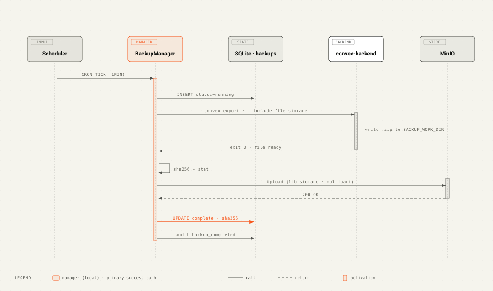
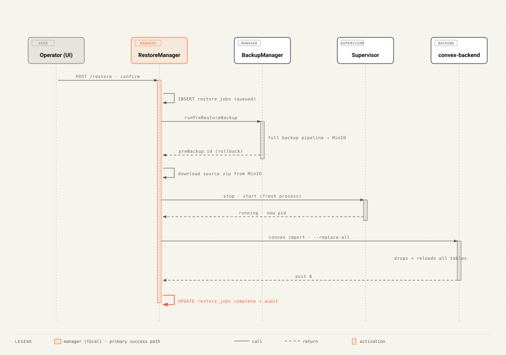

# Backups and restore

This guide covers how `convex-orchestrator` produces per-instance snapshot backups, how restores
work, and the operator playbooks for when things go sideways. For the high-level overview see the
README; for the engineering reference see [`architecture.md`](./architecture.md).

## Backup pipeline

One scheduled backup goes through five steps end to end: the in-process scheduler ticks every
minute, the manager inserts a `running` row, spawns `convex export --include-file-storage`,
hashes + uploads the resulting `.zip` to MinIO via `@aws-sdk/lib-storage`'s `Upload` helper, and
finally flips the row to `complete` with size + sha256. Manual backups skip the scheduler step;
everything else is identical.



## What is in a backup

A backup is a single `.zip` produced by the official `convex export --include-file-storage` CLI
against the instance's deployment URL. The zip contains the full database snapshot **and** every
file-storage entry. Convex guarantees the snapshot is internally consistent, i.e. the document
table and the storage IDs that documents reference are taken at the same logical timestamp.

`--include-file-storage` is non-negotiable. Restoring a backup that lacks file storage with
`--replace-all` would delete every `_storage` entry on the deployment. The orchestrator hard-codes
the flag for that reason; do not roll your own export pipeline that omits it.

**What is NOT in a Convex backup zip**, per the
[Convex docs](https://docs.convex.dev/database/backup-restore):

- **Environment variables**, re-set with `npx convex env set` after a restore
- **Schema, functions, crons, auth config**, redeploy with `npx convex deploy`

The orchestrator's restore-confirm dialog surfaces this explicitly so a user who, say, expects an
env var change to roll back along with a restore is not surprised. Tested end-to-end against the
NAS deployment on 2026-05-27.

## Storage layout

Each instance gets a dedicated MinIO bucket: `<instance>-backups`. Objects look like:

```
<instance>_<iso8601-timestamp>_v<convex-version>_<uuid>.zip
upload-<iso8601-timestamp>_<uuid>.zip      # uploaded restores get this prefix
```

The `backups` SQLite table mirrors every object with metadata: source (`auto`, `manual`, `manual-upload`, `pre-restore`), status, size, sha256, the Convex backend version stamp at backup time, plus the error message on failure. The UI reads from this table; MinIO is the durable storage but the SQLite row is what determines the displayed status.

## Scheduling

The scheduler lives in the orchestrator's Bun process, no host cron, no extra container. Defaults:

| Knob                         | Env var                           | Default                               |
| ---------------------------- | --------------------------------- | ------------------------------------- |
| Master switch                | `BACKUP_SCHEDULER_ENABLED`        | `true`                                |
| Default cron                 | `BACKUP_DEFAULT_CRON`             | `0 3 * * *` (03:00 daily, local time) |
| Retention                    | `BACKUP_RETENTION_DAYS`           | `30`                                  |
| Parallelism cap              | `BACKUP_MAX_CONCURRENT`           | `2`                                   |
| Export timeout               | `BACKUP_EXPORT_TIMEOUT_MINUTES`   | `30`                                  |
| Consecutive-fail threshold   | `BACKUP_MAX_CONSECUTIVE_FAILURES` | `3`                                   |
| Retention sweep hour         | `BACKUP_RETENTION_HOUR`           | `4`                                   |
| Orphan blob cleanup interval | `EXPORT_BLOB_CLEANUP_INTERVAL_MS` | `3600000` (1 h)                       |
| Orphan blob min age          | `EXPORT_BLOB_CLEANUP_MIN_AGE_MS`  | `900000` (15 min)                     |

Per-instance overrides (cron, retention, enabled) come from the UI's "Backup settings" panel and write to columns on the `instances` row. `null` means "use orchestrator default". Setting `enabled=true` clears any `backup_suspended` flag.

## Recovery playbooks

### A scheduled backup never ran

The Last-backup column in the overview is the canary. If it shows yellow (> 2× expected interval) or red (> 5×), check the instance detail page → audit log. Likely cases:

- `backup_auto_suspended` event → the instance hit `BACKUP_MAX_CONSECUTIVE_FAILURES`. Fix the underlying issue (e.g. backend OOM, MinIO offline, disk full), then flip the "Automatic backups enabled" toggle off and back on, that clears the suspension and reseeds the schedule.
- No event at all → check `BACKUP_SCHEDULER_ENABLED`. Boot logs will say `BACKUP_SCHEDULER_ENABLED=false, automatic backups disabled` if it's off.

### A backup is stuck

`convex export` can deadlock the backend if a prior export didn't finalise, Convex caches an `ExportInProgress` lock that only clears via process restart. The orchestrator detects this by watching for any `running` row older than `BACKUP_EXPORT_TIMEOUT_MINUTES` whose worker no longer owns it. The row gets marked `stuck`, the overview surfaces an orange "stuck" badge, and the detail page shows a banner with a `Force restart backend` button.

The button:

1. SIGTERMs the backend via the supervisor (10 s grace, then SIGKILL).
2. Respawns it immediately.
3. Audit-logs `backend_restart_for_stuck_export`.

The very next scheduled or manual backup proceeds normally.

### Restoring

The restore flow takes a `pre-restore` backup first, then stops and respawns the backend (to
clear any stale `ExportInProgress` lock), then runs `convex import --replace-all`. Any failure
before the import step aborts the restore with the original data intact.



Two paths, both end in the same `convex import --replace-all --include-file-storage` call:

1. **From the backup list**, pick a row, click `Restore`, type the instance name to confirm.
2. **From upload**, `Restore from upload…`, pick a `.zip`, type the instance name to confirm. The file is streamed straight to MinIO (no in-RAM buffering) and registered as a `manual-upload` backup row.

Before the destructive import runs, the orchestrator takes a `pre-restore` backup. If the
pre-restore step fails the whole restore is aborted with a 500, no data is touched. Convex's
import command itself enforces that the zip's `INSTANCE_NAME` matches the target deployment; a
cross-instance restore attempt is rejected with a clear error and the pre-restore backup is
preserved so you can roll back manually.

Restore jobs are persisted to SQLite (the `restore_jobs` table) so polling survives an
orchestrator restart. On boot, any job not in `{complete, failed}` is flipped to `failed` with a
marker message pointing at the audit log and the corresponding `pre-restore` backup ID; the
operator then decides whether to roll back or retry. Without this, every restart turned in-flight
polls into a generic 404 indistinguishable from "you typo'd the id".

### Manual recovery from a `pre-restore` row

`pre-restore` backups are intentionally exempt from the retention sweep, so you can roll back at any time after a botched restore by picking the `pre-restore` row and using its own `Restore` action.

### A backup is `corrupt`

The worker hashes the export zip during upload and re-hashes it from disk after upload. A mismatch flags the row `corrupt` with an audit entry. This is rare in practice (filesystem corruption between hash and close, or a botched stream). The fix is to delete the row + the object in MinIO and trigger a new backup; investigate the host's storage health if it repeats.

## Best practices

- **Test restores monthly.** A backup that has never been restored is not a backup. Pick a dev instance, restore the latest snapshot into it, verify the dashboard shows your seed data, then delete it.
- **Off-site sync for production instances.** The MinIO `<instance>-backups` bucket is a single point of failure if the MinIO volume dies. Add a sidecar that rsyncs new objects to a second target (S3-compatible, restic, whatever). The orchestrator does **not** ship this, it would either be too opinionated (restic / borg) or too half-baked (cron + mc mirror). Add it in your own ops layer.
- **Tune retention for large instances.** A daily 8 GB backup × 30 days = 240 GB. Either raise the retention floor (cheap MinIO) or drop the per-instance retention to 7-14 days via the settings panel.
- **Watch the disk on the Convex storage volume.** Convex itself never cleans up `exports/*.blob` files after the upload completes; the orchestrator's hourly orphan cleanup handles it, but a misconfigured `CONVEX_STORAGE_DIR_TEMPLATE` would silently bypass it. Sanity-check the path matches the binary's compiled-in directory after a Convex upgrade.

## What's intentionally NOT in scope

- Point-in-time recovery (Convex's export is a full snapshot; the granularity is whatever the cron says)
- Incremental / differential backups (same reason)
- Cross-region replication (Phase 2 idea: a second target adapter)
- Backup-zip encryption at the target (use MinIO server-side encryption if you need this)
- Cross-instance restore (Convex binds the zip to the original `INSTANCE_NAME`)
